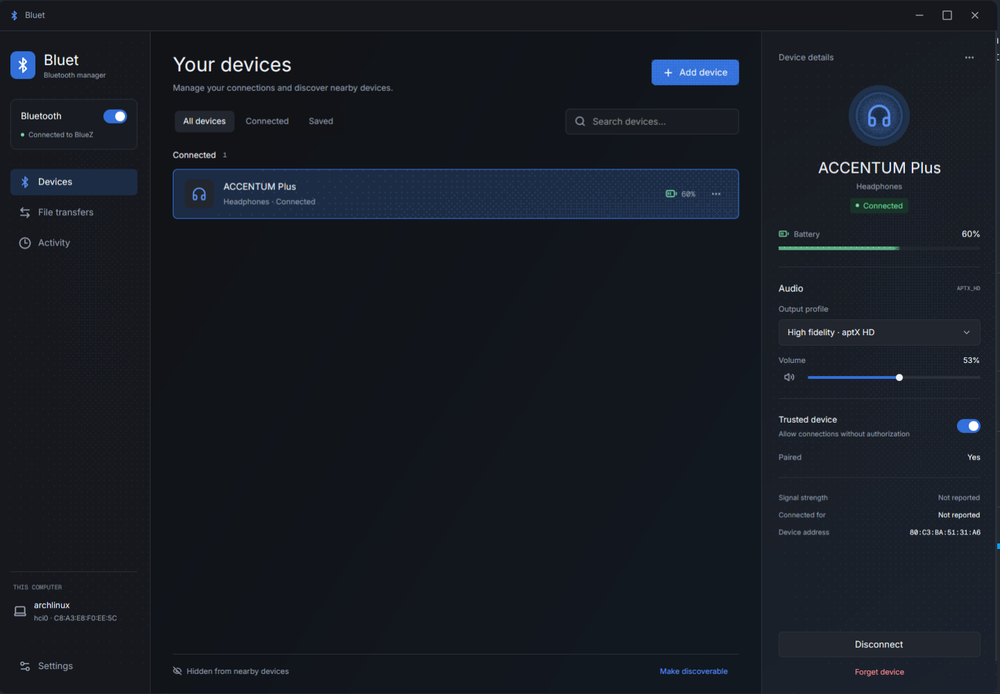
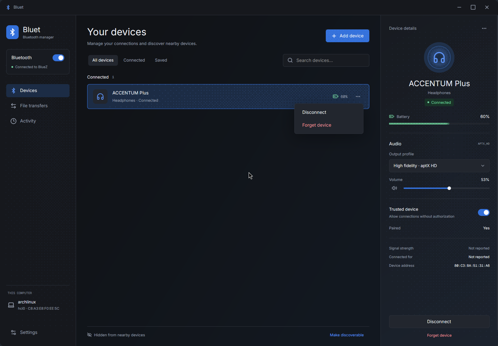

# Bluet



Bluet is a native Bluetooth manager written in **Rust with [GPUI](https://github.com/zed-industries/zed/tree/main/crates/gpui)** and built from the **BlueT.pen** design. GPUI renders the three-pane UI straight on the GPU. No browser, no Electron.

Bluet uses the **BlueZ service your system already runs**, talking to it over D-Bus with `zbus`. Device names, power, pairing, connection status, battery and trust all come from BlueZ. Audio controls go through the PipeWire or PulseAudio setup you already have, via `pactl`.

## Screenshots



These are screenshots of the actual app running on Arch Linux, not mockups.
The design references I compared them with are in `design/`.

## Install

Starting after v1.1.0, every [release](https://github.com/suryavamsi6/bluet/releases)
ships a prebuilt tarball and a Flatpak bundle for x86_64. Either way, you need the
system BlueZ `bluetoothd` service and a Vulkan driver.

### Prebuilt tarball (any distribution)

The binary is built on Ubuntu 22.04, so it runs on any distro with glibc 2.35
or newer.

```sh
version=1.1.1   # the release you want
curl -LO "https://github.com/suryavamsi6/bluet/releases/download/v${version}/bluet-${version}-x86_64-linux.tar.gz"
curl -LO "https://github.com/suryavamsi6/bluet/releases/download/v${version}/bluet-${version}-x86_64-linux.tar.gz.sha256"
sha256sum -c "bluet-${version}-x86_64-linux.tar.gz.sha256"
tar -xzf "bluet-${version}-x86_64-linux.tar.gz"
cd "bluet-${version}-x86_64-linux"
./install.sh                          # into ~/.local, with an app-menu launcher
# sudo PREFIX=/usr/local ./install.sh # or system-wide
# ./install.sh --uninstall            # remove again (same PREFIX)
```

You can also skip installing and run `./bin/bluet` right from the folder. The
tarball relies on your distro's own libraries (Vulkan loader, `libxkbcommon`,
Wayland/X11 client libraries, fontconfig and freetype), and any desktop install
already has those. Audio controls also need `pactl` (`pulseaudio-utils` on
Debian/Ubuntu/Fedora, `libpulse` on Arch).

### Flatpak bundle

```sh
version=1.1.1   # the release you want
curl -LO "https://github.com/suryavamsi6/bluet/releases/download/v${version}/bluet-x86_64.flatpak"
flatpak install --user bluet-x86_64.flatpak
flatpak run io.github.suryavamsi6.bluet
```

If you don't have the `org.freedesktop.Platform` runtime yet, the bundle pulls
it from Flathub, so Flathub has to be set up as a remote. The sandbox gets
access to Wayland (with X11 as a fallback), the GPU, the system BlueZ service on
D-Bus, and the PulseAudio/PipeWire socket. `pactl` comes from the runtime.
Bluet isn't on Flathub yet (see
[packaging/flatpak/FLATHUB.md](packaging/flatpak/FLATHUB.md)). To build the
bundle yourself:

```sh
packaging/flatpak/update-cargo-sources.sh
flatpak-builder --user --install --force-clean --install-deps-from=flathub \
  build-dir packaging/flatpak/io.github.suryavamsi6.bluet.yml
```

## Run

You'll need Rust, a Linux desktop with working Vulkan drivers, and the system's BlueZ `bluetoothd` service. Bluet runs with your desktop user's normal D-Bus/PolicyKit permissions. If your audio server exposes a Bluetooth card or output, `pactl` turns on the audio controls.

```sh
cargo run --release
```

On startup, Bluet only reads the current state and subscribes to changes. It won't power on an adapter, start a scan, pair, connect, or touch your audio.

## Build

```sh
cargo build --release
./target/release/bluet
```

Fonts, icons and dither textures are baked into the binary. The system services and `pactl` still come from your OS.

## Verification

```sh
cargo test
dbus-run-session -- sh -c 'DBUS_SYSTEM_BUS_ADDRESS="$DBUS_SESSION_BUS_ADDRESS" cargo test --test dbus_integration'
cargo build --release
./scripts/native-smoke.sh
./scripts/native-smoke.sh --capture
./scripts/parity-check.py artifacts/bluet-native.png
```

The unit tests cover device filtering, BlueZ property mapping, audio parsing, the audio command bridge and dither texture generation. The D-Bus integration test spins up a fake BlueZ service on a private `dbus-run-session` bus and runs through real marshalling, signals, discovery, connection, trust, removal and pairing-agent confirmation and rejection. It never touches real Bluetooth hardware.

The native smoke test opens the real GPUI window against the installed service, checks that it renders and stays up, and compares adapter and device state before and after. Under Hyprland it can also grab a screenshot with `grim`. It stays away from power, discovery, pairing, connection, trust, removal and audio write controls on purpose.

`scripts/parity-check.py` compares a screenshot region by region against the committed reference frame. It corrects for the small, constant offset in where a live window lands, so a layout regression fails loudly instead of getting lost in the flat backgrounds. Point it at whichever frame `native-smoke.sh --capture` produced.

## Arch Linux package

### From the AUR

```sh
yay -S bluet        # or: paru -S bluet
```

The AUR recipe downloads the tagged source archive from GitHub and builds it on
your machine, so it follows releases. `./scripts/package-aur.sh` generates the
recipe into `dist/aur/` from the published tag, and `./scripts/check-aur-recipe.sh`
checks that its checksum matches the archive the tag actually serves.

The recipe isn't committed here, and it can't be. It stores a checksum of the
release archive, that archive is built from the committed tree, and git stamps
archived files with the commit time. Committing the recipe would change the very
bytes it describes, so no committed copy could stay valid. The published recipe
and its history live in the AUR repository. This repo keeps the generator,
`packaging/aur/PKGBUILD.in`.

### From a local checkout

Make sure `base-devel`, `cargo`, `rust`, `pkg-config` and `desktop-file-utils` are installed, then run:

```sh
./scripts/package-arch.sh
sudo pacman -U dist/arch/bluet-*-x86_64.pkg.tar.zst
```

The script builds from your current checkout, checks the source archive checksum, runs the unit tests and gives you an installable package. That package ships the desktop launcher and icon, depends on BlueZ and the usual graphics libraries, and uses `libpulse` for `pactl`. It doesn't install a PulseAudio server or change any Bluetooth service settings. You'll also need the right Vulkan driver for your machine.

The generated source archive, checksum-pinned `PKGBUILD` and `.SRCINFO` end up in `dist/arch/` too. To prepare those without building, run `./scripts/package-arch.sh --prepare-only`. The recipe template under version control is `packaging/arch/PKGBUILD.in`, and none of this needs a public GitHub release.

## Releases

On every push and pull request, `.github/workflows/ci.yml` runs the tests, the
D-Bus integration test, clippy and `cargo fmt --check`. It also builds the
release binary on Ubuntu 22.04 with its tarball, plus a Flatpak bundle, and you
can download both as workflow artifacts.

Pushing a `v*` tag goes further. It creates the GitHub release, attaches the
bare binary, the tarball with its `.sha256` and the Flatpak bundle, and
publishes the recipe to the AUR, generated from that tag's archive and checked
against it before the push. Release notes are only generated once, so
re-running the job just replaces the files.

```sh
# bump Cargo.toml's version, commit, then tag that commit:
git commit -am "Release 1.1.1"
git push origin main
git tag v1.1.1
git push origin v1.1.1
```

The AUR step needs three repository secrets: `AUR_SSH_PRIVATE_KEY`,
`AUR_USERNAME` and `AUR_EMAIL`. The private key has to be the other half of the
key registered in your AUR account settings. There's no submission form; the
first push to a package's git repo is what creates the package.

## Nix and NixOS

The flake supports `x86_64-linux`:

```sh
nix build .#bluet
nix run .#bluet
```

The Nix package builds from source with the dependency versions pinned in `Cargo.lock` and brings its own native Wayland/X11, Vulkan, font and audio libraries. It includes the desktop launcher and icon. Bluetooth and audio services still come from your OS.

To use it in a NixOS config, add this checkout as a flake input:

```nix
inputs.bluet.url = "path:/absolute/path/to/bluet";
```

Then import the module in a system config that gets `inputs` passed in:

```nix
imports = [ inputs.bluet.nixosModules.default ];
programs.bluet.enable = true;
```

The module is opt-in. It installs Bluet, turns on `hardware.bluetooth.enable`, and leaves your audio setup alone. Runtime details are in [nix/README.md](nix/README.md).

## Controls

- Power and visibility change the real BlueZ properties on the selected adapter.
- Add device starts a discovery session for Bluet only. Closing the dialog ends that session without stopping a scan another app is running.
- Pairing goes through an agent Bluet registers itself. PIN, passkey, confirmation and authorization requests show up in the app, and the system's default pairing agent stays in place.
- Connect, disconnect, forget and trust act on the actual selected device. Forget asks first, then removes the pairing keys.
- Volume, mute and audio profiles apply to the selected Bluetooth output or card. Dragging the volume slider commits once, when you let go. If an audio control isn't available, the app tells you why.
- Activity logs the changes Bluet sees while it's open. When battery, signal or connection time is unknown, it says so instead of guessing.

File transfers aren't implemented. The UI says so and doesn't pretend it can send files. Layout, colors, typography and icons follow the Pen reference, and ordered-dither accents give texture to the sidebar, inspector, selected device, device halo, primary buttons, battery meter and pairing panels. The reference exports are in `design/`.

The dither effects are a Rust adaptation of [dither-kit-rs](https://github.com/DeepanshuMishraa/dither-kit-rs)'s Bayer8 technique and field vocabulary. Textures are generated deterministically and cached as native GPUI images behind text and controls, with no animation loop. The upstream MIT license is in `assets/licenses/DitherKit-LICENSE`.

Inter and Geist Mono are bundled under the SIL Open Font License, and the Lucide icons are under the ISC license. License texts for dependencies and assets are in `assets/licenses/`.

## License

Bluet is licensed under either of

- Apache License, Version 2.0 ([LICENSE-APACHE](LICENSE-APACHE))
- MIT license ([LICENSE-MIT](LICENSE-MIT))

at your option. Unless you explicitly state otherwise, any contribution
intentionally submitted for inclusion in Bluet by you, as defined in the
Apache-2.0 license, shall be dual licensed as above, without any additional
terms or conditions.

Bundled fonts, icons and adapted code keep their own licenses, listed above
with full texts in `assets/licenses/`. Every package installs both the project
licenses and those third-party license texts.
